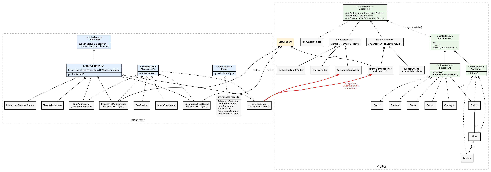

# Plant Monitor: Observer and Visitor (Assignment 6, Variant 17, Industrial IoT)

A small Java 17 system for a factory floor. Machines send telemetry, listeners react to it (Observer).
The factory itself is a stable tree that gets new operations without changing its classes (Visitor).
Only JUnit 5, no other libraries.

## Run

```
mvn test
mvn -q compile exec:java
```

Console menu: 1 run simulation (you type the thread count), 2 dashboard, 3 inject vibration,
4 inject overheating, 5 run visitors, 6 JSON export, 7 attach a one-shot printer, 0 exit.

## Observer side

Two sources (subjects): `TelemetrySource` (machine readings) and `ProductionCounterSource` (good and rejected units).
Both extend `EventPublisher<E>`, which implements my own generic `Subject<E>`. Listeners implement `Observer<E>`.

Six listeners:

| Listener | Subscribes to | What it does |
|---|---|---|
| `ScadaDashboard` | everything | counts events, keeps the latest reading, line summaries and tickets |
| `PredictiveMaintenance` | TELEMETRY | vibration over the limit marks the machine FAULT and publishes an alert |
| `EmergencyStopGuard` | TELEMETRY | temperature over the limit stops the machine and publishes an emergency event |
| `OeeTracker` | PRODUCTION | availability x performance x quality per station |
| `LineAggregator` | PRODUCTION | **listener and subject**: sums production per line and republishes `LineSummary` |
| `AlertService` | ALERT | integration point, see below |

Chain of observers: source, then `LineAggregator`, then `ScadaDashboard`.

Events are immutable records with a type (`TelemetryReading`, `ProductionCount`, `LineSummary`,
`AlertRaised`, `EmergencyStopped`, `MaintenanceTicket`). Listeners subscribe per `EventType`.

**Push, not pull.** The event carries all the data. A pulling listener would have to call back into the
source while other threads are changing it, which needs locks. A pushed immutable record needs none.

**Thread-safe registry without locking the subject.** One `CopyOnWriteArrayList` per event type, all created
in the constructor (no lazy init). Publishing iterates over a snapshot, so a listener can subscribe or
unsubscribe at any moment, even from inside its own handler, and no other thread waits for it.
A listener that throws does not stop the others: the rest are called and the first exception is rethrown.

## Visitor side

Composite tree: `Factory` -> `Line` -> `Station` -> equipment (3 container types, leaves `Robot`, `Conveyor`,
`Sensor`, `Press`, later `Furnace`). Elements are immutable records with data and one method, `accept`.

`Visitor<R>` has one method per element type. `element.accept(visitor)` calls `visitor.visitRobot(this)`:
the first dispatch picks `accept` by the element's real class, the second picks the visitor method by `this`.
The client cannot call `visitor.visit(node)` because Java chooses the overload at compile time from the
static type, and a variable of type `PlantElement` matches no `visitX` method.

Visitors:

| Visitor | Kind | Result |
|---|---|---|
| `EnergyVisitor` | numeric calculation | total kW of a subtree |
| `DowntimeCostVisitor` | numeric calculation | cost per hour if the subtree stops |
| `InventoryVisitor` | accumulates state over the whole tree | count per element type |
| `FaultyElementsFilter` | filter | list of elements whose status is not OK |
| `JsonExportVisitor` | hand-written export | nested JSON |

**Who traverses: the visitor.** Elements hold data only, and different operations need different walks
(the integration visits only one station). To avoid copying the loop, two small base classes do it once:
`FoldVisitor` for pure calculations and `WalkVisitor` for stateful ones. The JSON visitor needs type-specific
fields, so it implements the interface directly.

Machine status (OK, FAULT, STOPPED) lives in `StatusBoard`, not in the elements, so the tree stays immutable.

## Integration

`PredictiveMaintenance` publishes an alert. `AlertService` receives it and runs `FaultyElementsFilter` and
`DowntimeCostVisitor` **on that station only** (`station.accept(...)`), then publishes a `MaintenanceTicket`
as a new event, which the dashboard receives. Alert, inspection, ticket.

## Concurrency

`ProducerPool` wraps an `ExecutorService` with a configurable thread count. Producers publish synchronously,
so when `runAll` returns every event has been delivered. `close()` calls `shutdown()` and waits;
if threads do not finish in 10 seconds it calls `shutdownNow()` and fails loudly. State is held in
`ConcurrentHashMap` (atomic `merge`/`compute`) and `LongAdder`. Status changes use `compute`,
so 4 threads hammering one faulty machine raise exactly one alert.

## Clean Code

One composition root, `PlantSystem`. Constructor injection only, no setters, no lazy init in business code.
No comments, names explain the code. Every interface has a reason: it has more than one implementation or
it is the extension point.

## Trade-off proof (two separate commits)

**Commit `687b054`: new visitor, no element class touched.** `CarbonFootprintVisitor`.

- `src/main/java/plant/visitor/CarbonFootprintVisitor.java` (new)
- `src/test/java/plant/visitor/CarbonFootprintVisitorTest.java` (new)

Cost: one class, zero edits. This is what Visitor is good at.

**Commit `3a35471`: new element type.** `Furnace`.

- `src/main/java/plant/model/Furnace.java` (new)
- `src/main/java/plant/visitor/Visitor.java` (new method `visitFurnace`)
- `src/main/java/plant/visitor/FoldVisitor.java`
- `src/main/java/plant/visitor/WalkVisitor.java`
- `src/main/java/plant/visitor/JsonExportVisitor.java`
- `src/test/java/plant/visitor/VisitorTest.java` (its anonymous visitor must implement the new method)
- `src/test/java/plant/visitor/FurnaceTest.java` (new)

Cost: the interface changed, so **every visitor must change**. Only 3 files needed edits because
`FoldVisitor` and `WalkVisitor` absorb the change for the four visitors built on them; only the JSON visitor,
which writes type-specific fields, was touched by hand. With many visitors that each treat element types
differently, this cost grows with every new element. **I would reject Visitor if new element types arrive
more often than new operations**; then a plain method on the elements (or polymorphism) is cheaper.

## Tests

52 JUnit tests: publisher (subscribe, unsubscribe, subscribe and unsubscribe from inside a handler,
failing listener, unsubscribe while 4 threads publish), events, sources, each visitor against hand-calculated
numbers (factory 97.0 kW, downtime 3250.0/h, station S1 15.5 kW, OEE 0.5667), double dispatch, subtree-only
visits, listeners, the integration chain, the stress test (4 threads x 1000 events, exact counts at every
listener), exactly-one alert and exactly-one emergency stop under 4 threads, pool shutdown, demo scripts.

## UML



Source: `docs/uml.dot` (also `docs/class-diagram.svg`).

## Demo script

1. Option 1, `4`, `1000`: 4 threads x 1000 events. Telemetry, production and line summary counters all show 4000.
2. Option 7 (attach printer), option 3 with `S3`, `R3`, `9`: alert, ticket for S3 only (R3 faulty, 900.0/h),
   printer prints and leaves.
3. Option 3 again with `S1`, `R1`, `9`: the printer stays silent, a second ticket appears for S1 only (700.0/h).
4. Option 4 with `S2`, `P1`, `150`: emergency stop.
5. Option 5 with `F1`: energy 97.0, cost 3250.0, inventory, faulty list (R1, P1, R3).
6. Option 6 with `S1`: the nested JSON.
